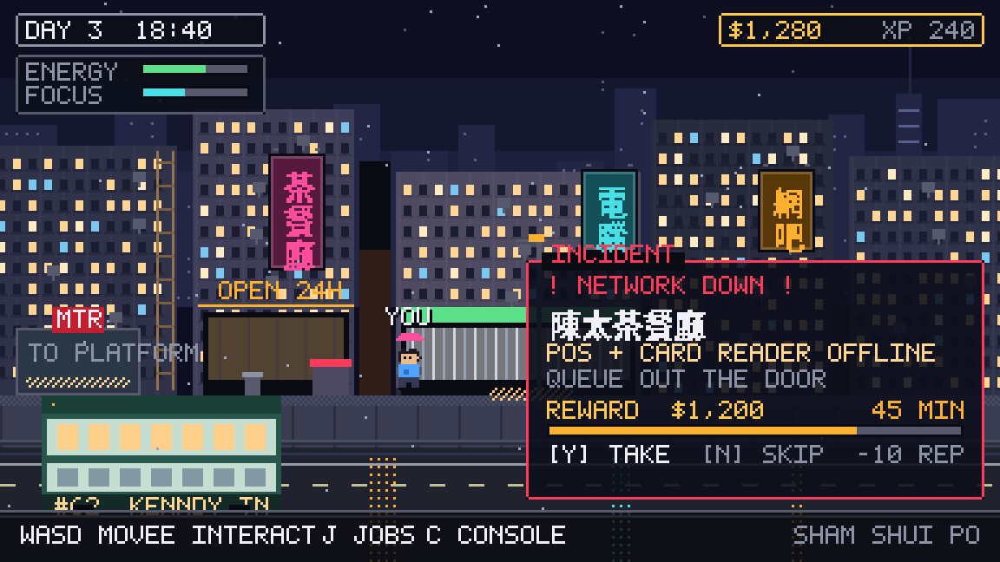
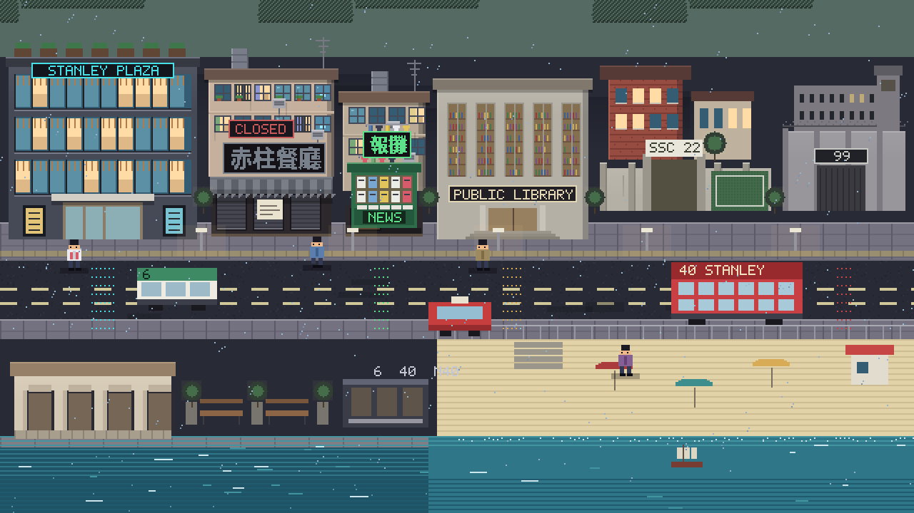

# NETLIFE: Hong Kong

A browser-based pixel-art life sim for teaching networking to HKDSE ICT students.

You are a school leaver in Sham Shui Po with a second-hand laptop. You take IT jobs,
get paid, get burned, rent a walk-up studio, wire your first flat — and every job you
accept is a real networking task, scored.



**Status:** v0.11, the one-street game. Back to Tung Tau Wan Road, Stanley, on one screen, on the
school server: everyone sees each other walking, a wealth leaderboard, news from the past 12 hours,
and Stanley Prison with its inmates (by class number) on show. Questions are multiple choice and
written answers; written answers are marked by the school AI.

**Read first:** [One street](docs/design/one-street.md): the decisions behind v0.11. The village
(v0.5-v0.10) is in the git history and in [stanley-expansion.md](docs/design/stanley-expansion.md).



**Play:** <https://ai.ssc.edu.hk/cit-game/> · **Teacher page:** <https://ai.ssc.edu.hk/cit-game/admin>

```bash
npm install && npm run build            # checks, typecheck, -> dist/
SPARK_API_KEY=... ADMIN_KEY=... npm run server
```

WASD / arrows or tap to walk, **E** to go in, **L** for the news stand, **U** mutes. In a quiz, **A-D**
or **1-4** answers and **Enter** moves on; a written answer opens a box to type in. You start with
$500. Living costs are **$2 every real hour**, even while you are away (never below $0).

| Building, left to right | What |
|---|---|
| Stanley Plaza | all work. **Freelance**: a board of one-off gigs (new every 3 real hours), paid per right answer, reputation for finishing. **Companies**: interview (3 MCs, 2 to pass), then a task every 5 real hours; relaxed bosses fire at 5 days, strict at 3 |
| Stanley Restaurant | closed for now |
| News stand | the richest in Stanley and the news from the past 12 hours: hires, firings, arrests, exam passes, a new richest player |
| Stanley Public Library | study notes by topic (until the notes are written: revision cards from the question bank) |
| St Stephen's College | exams: MCs and one written answer; 70% to pass. Some gigs and companies need them. Reputation on the first pass only |
| Stanley Prison | how many are inside, shown on the building; inside, each inmate by class number and offence |

People stop you in the street: some have a quick paid job, some are traps (log into someone's
account, sell copied discs, install cracked software). Every trap shows its warning signs; walking
away is always safe. A first minor offence is a warning and a fine; anything else is 30 real
minutes in Stanley Prison. Reputation (never below 0) goes up for freelance work and exams, down
for being fired or arrested.

## What v0.3 changed

- **No Phaser.** The game draws itself to one 640×360 canvas on a loop it owns. The bundle went from
  1.5 MB to **19.7 kB (8 kB gzipped)**, which is the difference between a two-second iPad load and
  an instant one. Phaser's scene manager was also silently dead in the test browser: transitions
  queued and never ran, so a second scene rendered once and then froze. Scenes are now modes.
- **The street is alive.** Rain, four pedestrians with umbrellas, a car with headlights, neon glow
  above the night grade, wet-asphalt smears under the shop signs, flickering signage, and a light
  pool per lamp — all drawn per frame, none baked into the map.
- **Sound.** A procedural lo-fi loop (pad, bass, arpeggio, hat) plus SFX for keys, correct answers,
  wrong answers, cash, doors and footsteps — synthesised at runtime, so no audio files and no
  licensing.
- **The road band is measured, not guessed.** `map.png` was sampled row by row to find the asphalt
  (y 184–212) so the player walks on the road and pedestrians walk the pavement. Spots carry two
  vertical anchors: one on the road for reach, one on the shopfront for the marker.

## Read this first

- **[Game design document](docs/design/game-design-document.md)** — pillars, systems, curriculum mapping, demo scope, risks, open questions.
- **[Layout spec](docs/design/layout-spec.md)** — the grid every screen is drawn to, and the defects the visual pass caught.

## Visual direction

All mockups are generated pixel art (native 384×216, 3× upscale), not AI images:

| | |
|---|---|
| [City + sudden-mission alert](docs/mockups/01-city-night.png) | the overworld and the timed-incident interrupt |
| [Job ticket + diagnostic console](docs/mockups/02-job-console.png) | the learning surface: read real console output, name the fault |
| [Home network build](docs/mockups/03-home-network.png) | the housing capstone: plan, cable, score coverage/cost/security |
| [The ladder](docs/mockups/04-progression.png) | housing tiers and the employed / own-business fork |
| [The wire](docs/mockups/05-wire.png) | the headline strip: live news, richest-player fallback, breaking push |
| [iPad layout](docs/mockups/06-ipad.png) | the same job screen at 4:3 with a touch action bar |
| [The hub](docs/mockups/07-hub.png) | the front door: one next action, live board, cold resume |

Regenerate them:

```bash
python3 tools/mockup/build.py                     # needs Pillow + Noto Sans CJK HK
PIXEL_AUDIT=1 python3 tools/mockup/build.py       # also reports anything drawn off-canvas
```

`tools/mockup/pixelart.py` holds the canonical palette and the 5×7 bitmap font,
`tools/mockup/ui.py` holds the screen grammar (scrims, prompt line, paper, sticky) —
copy those values into the game, do not invent a second style.

**Layout rule:** one focus surface per screen, three permanent numbers, one prompt line,
and edges only on things that are physical objects. See §7.1 of the design doc.

## Adding questions

Fill in `content/question-bank-template.csv` (one row per MC: form 1–6, topic, question, four
options, answer letter, explanation), then:

```bash
npm run import -- content/your-bank.csv   # writes src/questions-imported.ts
npm run check                             # validates every question
```

Written questions live in `src/essays.ts` (a question, 2-4 marking points with keywords, a model
answer); study notes in `src/notes.ts`. The format is at the top of each file.

## Stack

TypeScript + Vite, one 640×360 canvas, no Phaser; a small Node server (`server/main.ts`, no
packages) owns the economy. Content is TypeScript data (`src/questions.ts`, `src/essays.ts`,
`src/notes.ts`, `src/economy.ts`), checked at build time by `npm run check`.

Runs in a browser on **school laptops (keyboard + mouse) and iPads (touch, landscape)**:
fixed 384 px design width with fluid height (216–272), every touch target ≥24 px
(≈70 pt), no OS keyboard anywhere, IndexedDB saves plus a copy-paste save code.
See §8.2 of the design document.

## Open decisions

Seven questions are waiting on the teacher in §12 of the design doc — syllabus binding,
lesson shape, grades vs practice, business-sim scope, who authors content, whether the
leaderboard needs a real backend at launch, and how player handles are chosen.
