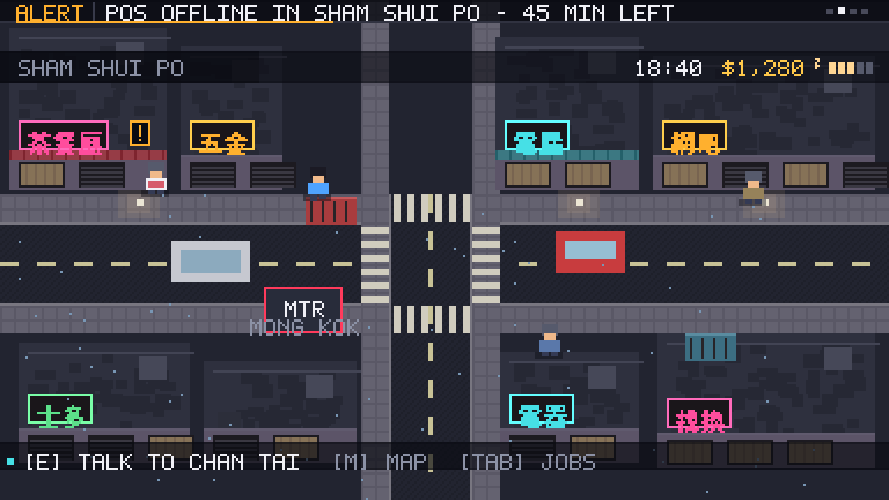

# NETLIFE: Hong Kong

A browser-based pixel-art life sim for teaching networking to HKDSE ICT students.

You are a school leaver in Sham Shui Po with a second-hand laptop. You take IT jobs,
get paid, get burned, rent a walk-up studio, wire your first flat — and every job you
accept is a real networking task, scored.



**Status:** concept — design doc written, visual direction fixed, nothing playable yet.

## Read this first

- **[Game design document](docs/design/game-design-document.md)** — pillars, systems, curriculum mapping, demo scope, risks, open questions.
- **[Layout spec](docs/design/layout-spec.md)** — the grid every screen is drawn to, and the defects the visual pass caught.

## Visual direction

All mockups are generated pixel art (native 384×216, 3× upscale), not AI images:

| | |
|---|---|
| [City + sudden-mission alert](docs/mockups/01-city-night.png) | the overworld and the timed-incident interrupt |
| [Job ticket + diagnostic console](docs/mockups/02-job-console.png) | the learning surface: read real console output, name the fault |
| [Home network build](docs/mockups/03-home-network.png) | the housing capstone: plan, cable, score coverage/cost/security |
| [The ladder](docs/mockups/04-progression.png) | housing tiers and the employed / own-business fork |
| [The wire](docs/mockups/05-wire.png) | the headline strip: live news, richest-player fallback, breaking push |
| [iPad layout](docs/mockups/06-ipad.png) | the same job screen at 4:3 with a touch action bar |
| [The hub](docs/mockups/07-hub.png) | the front door: one next action, live board, cold resume |

Regenerate them:

```bash
python3 tools/mockup/build.py                     # needs Pillow + Noto Sans CJK HK
PIXEL_AUDIT=1 python3 tools/mockup/build.py       # also reports anything drawn off-canvas
```

`tools/mockup/pixelart.py` holds the canonical palette and the 5×7 bitmap font,
`tools/mockup/ui.py` holds the screen grammar (scrims, prompt line, paper, sticky) —
copy those values into the game, do not invent a second style.

**Layout rule:** one focus surface per screen, three permanent numbers, one prompt line,
and edges only on things that are physical objects. See §7.1 of the design doc.

## Planned stack

Phaser 3 + TypeScript + Vite, content in JSON, static deploy to GitHub Pages.

Runs in a browser on **school laptops (keyboard + mouse) and iPads (touch, landscape)**:
fixed 384 px design width with fluid height (216–272), every touch target ≥24 px
(≈70 pt), no OS keyboard anywhere, IndexedDB saves plus a copy-paste save code.
See §8.2 of the design document.

## Open decisions

Seven questions are waiting on the teacher in §12 of the design doc — syllabus binding,
lesson shape, grades vs practice, business-sim scope, who authors content, whether the
leaderboard needs a real backend at launch, and how player handles are chosen.
