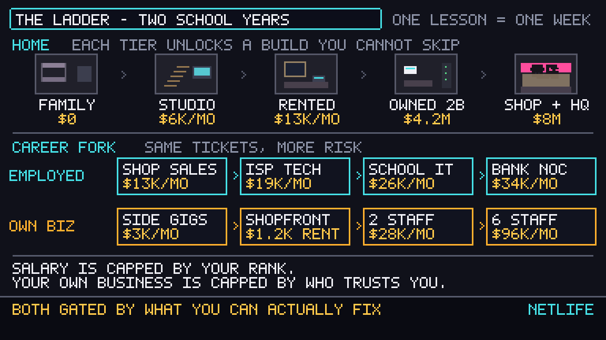
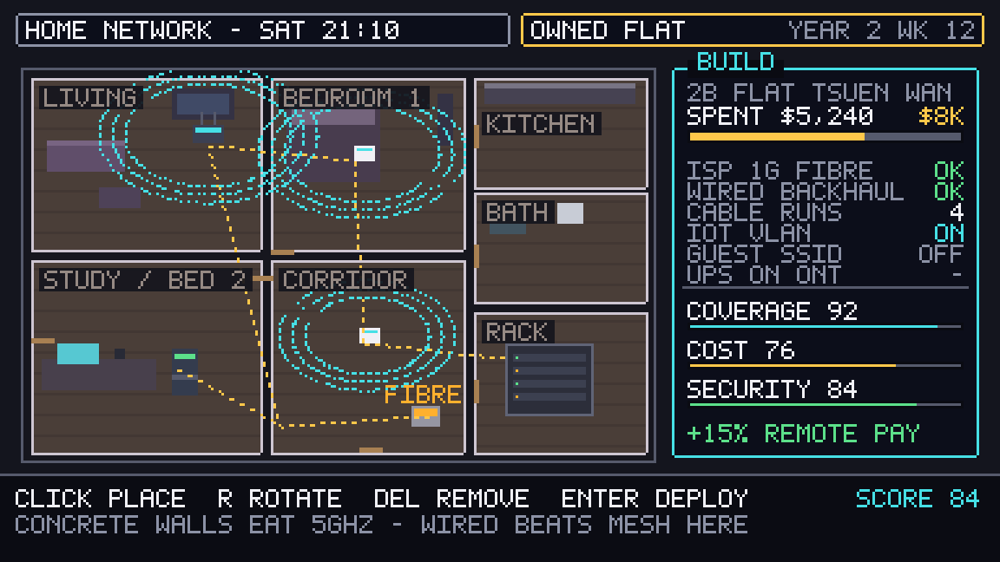
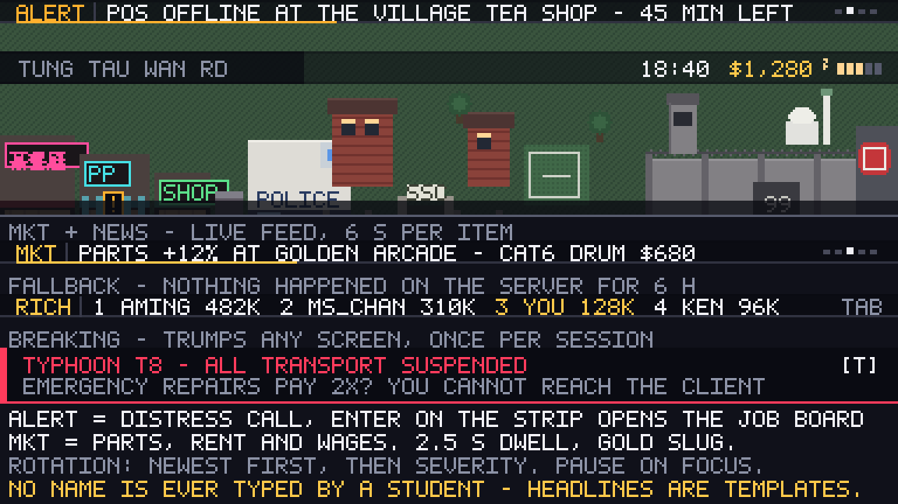
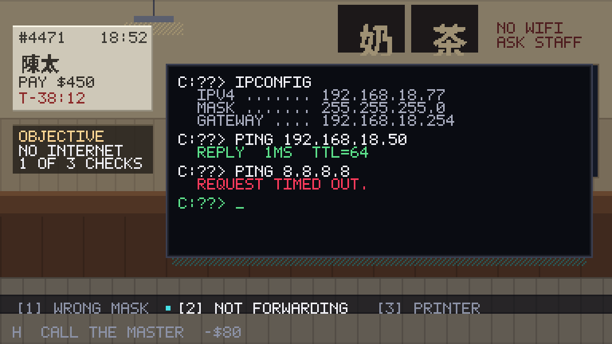

# NETLIFE: Hong Kong — game design document

**A pixel-art life sim that teaches networking to HKDSE ICT students.**

| | |
|---|---|
| **Status** | Concept v0.3 — direction agreed, systems drafted, UI decluttered to a spec, demo not yet built |
| **Owner** | Ryan (ICT) · SSC-Program-Team |
| **Repo** | `SSC-Program-Team/cit-game` |
| **Platform** | Browser: laptop (keyboard + mouse) and iPad (touch, landscape), offline-capable |
| **Audience** | S4–S6 ICT (DSE), real subnetting and OSI rigour |
| **Language** | English at launch, 繁中 in v1.1 |
| **First milestone** | One-lesson demo: 1 room, 3 jobs, 20 graded tasks |

---

## 1. What it is

You are an 18-year-old school leaver in Hong Kong with a CompTIA study guide, a second-hand laptop and no money. Over two school years of in-game weeks you take IT jobs, get paid, get burned, rent a walk-up studio, split a flat network for a 茶餐廳 owner, buy your first flat — and have to wire it yourself.

The work *is* the game. There is no separate quiz screen bolted onto a story: every job you accept is a networking task, scored, and the money you earn from it is what buys your next tool, your rent, your rack.

```
   ┌──────────────────────────────────────────────────────────────┐
   │  JOB BOARD  →  ON SITE  →  DIAGNOSE/CONFIGURE  →  PAID       │
   │      ↑                                   │            │      │
   │      │                                   ↓            ↓      │
   │   REPUTATION ←──── CLIENT RATING ←── REWORK     MONEY + XP   │
   │      │                                                │      │
   │      └──────── BETTER JOBS ←── RANK ←──── SKILL TREE ←┘      │
   │                                                              │
   │  SINK: rent · tools · transport · food · staff · mortgage     │
   │  VALVE: sudden incidents (+pay, +risk) · city events          │
   └──────────────────────────────────────────────────────────────┘
```


*Sham Shui Po, 18:40, day 3. A timed incident lands while you are walking home. Accepting costs energy and a block of your evening; skipping costs reputation — and 陳太 will remember.*

---

## 2. Design pillars

1. **The ticket is the lesson.** No task exists that is not something a technician actually does. If a task cannot be justified as "someone gets paid to do this", it is cut.
2. **Money is the scoreboard, mastery is the gate.** Money is visible and motivating; mastery decides which jobs you are allowed to accept. You cannot buy your way past a subnetting gate.
3. **Fail forward.** No game over, no lives. A wrong diagnosis costs in-game time, money and reputation, then hands you a rework scene that shows what the evidence actually meant.
4. **Hong Kong is the setting, not the skin.** Concrete walls eat 5 GHz. Landlords refuse drilling. Parts are cheap in 黃金商場 and the queue at the till is the actual reason the job is urgent.
5. **A teacher can author content without touching the game.** Every question, job and scoring rule lives in JSON, validated in CI.

---

## 3. Who plays it, and what it must teach

### 3.1 Players

- **Primary:** S4–S6 ICT students, in class, 35–40 minute lessons, one student per machine — school laptops *and* iPads, same build, same save format.
- **Secondary:** S5–S6 revision at home, and juniors (S1–S3) playing the same build on an easier job tier.
- **Tertiary:** the teacher, who needs to see *which topic* a class is weak on without reading 30 save files.

### 3.2 Curriculum binding

The first content pack binds to the DSE ICT networking surface: compulsory **Unit 3 (Internet and its applications)** plus the **Data Communications and Networking** elective, with junior CIT basics as the floor.

| Topic | Taught by task type | Mastery gate |
|---|---|---|
| Network types, LAN/WAN, topologies | **PATCH** — map desk ports through a panel to switch ports | S1 |
| OSI / TCP-IP layers | **DIAGNOSE** — layered elimination from console output | S2 |
| IP addressing, masks, private vs public | **ADDRESS** — configure a device, arithmetic validated | S3 |
| Subnetting / VLSM | **SUBNET** — carve a block to fit departments | S4 |
| DHCP (pool, lease, scope options) | **DIAGNOSE + ADDRESS** — exhausted pool, wrong scope | S5 |
| DNS (resolution, records, nslookup) | **DIAGNOSE** — ping IP works, name fails | S6 |
| ARP, MAC, switching, MAC tables | **DIAGNOSE** — duplicate IP, stale ARP | S7 |
| Routing, default gateway | **DIAGNOSE** — tracert stops at hop 1 | S8 |
| Wireless: bands, channels, coverage | **SURVEY** — place APs, 1/6/11, 5 GHz reality | S9 |
| Cabling: UTP, Cat5e/6, T568A/B, fibre | **CRIMP + PATCH** — sequencing and standard | S10 |
| Network security: WPA2/3, VLAN, firewall, UPnP | **AUDIT** — toggle the dangerous settings | S11 |
| Troubleshooting methodology | the whole ticket flow | S12 |
| Social, legal, impact (PDPO, acceptable use) | **EXPLAIN** — choose the right thing to tell a client | S13 |

> **Assumption to confirm:** that the school's "CIT" is the DSE ICT line above and not a separate junior-secondary CIT syllabus with its own topic list. If it is the junior syllabus, the task types hold but the topic table gets re-cut simpler and subnetting moves to an optional "hard mode" pack. See §12 Q1.

---

## 4. Systems

### 4.1 Time

- One school lesson ≈ **one in-game week**. A lesson opens on Monday morning; the week closes with rent due.
- Each day has **4 blocks**: morning, afternoon, evening, night. A job costs 1–2 blocks, travel 1, sleep resets energy.
- The clock only advances when the player acts — no real-time pressure, so a slow reader is never punished for reading.
- **Full campaign = 30 weeks** (one school year of lessons). The demo is week 1.

### 4.2 The job loop

1. **Board** — 3–5 open jobs, each with client, symptom, pay, time limit, required tools and required rank.
2. **Travel** — walk the district or take the MTR (costs money, saves blocks).
3. **On site** — the client tells you the symptom (often wrong or incomplete). You get one *camera-feed* view of the room and your toolset.
4. **Work** — a sequence of 4–8 graded tasks using the task types in §5.
5. **Payment** — the fee scales with tasks passed, time used and reputation; a bungled job pays partial and drops reputation.
6. **Report** — a 2-line summary you must *also* get right: the EXPLAIN task is what most students lose money on, and it is the one thing clients remember.

### 4.3 Economy

Currency is HKD. First-pass tuning (flagged for a balance spreadsheet before it ships):

| Item | Amount |
|---|---|
| Trainee ticket job (1 block) | $300 – $900 |
| Technician callout (1–2 blocks) | $1,200 – $2,500 |
| Engineer contract (2 blocks) | $3,000 – $9,000 |
| Salary track (monthly) | $13k → $52k |
| Rent: 唐樓 studio | $6k / mo |
| Mortgage: 2-bed | $4.2M, 10% down |
| Tools: cable tester / crimper / toner / fluke | $180 → $4,800 |
| Transport: walk / MTR | $0 / $12 per hop |

Tools gate job tiers as hard as XP does — a subnetting prodigy with no cable tester still cannot take the structured-cabling contract.

### 4.4 Career fork

From week ~6 the player chooses how to earn, and can mix:

- **Employed** — fixed hours, fixed salary, employer pays for courses and certs, promotions gated by rank *and* client-free mastery. Lower ceiling, no downside risk.
- **Own business** — register a BR, take the same tickets at higher margin, buy stock, hire staff, rent a shopfront (黃金商場-style), eventually run a rack room. Staff multiply income and multiply the failure modes: an untrained hire botches jobs you never see, and *you* pay the reputation.



### 4.5 The housing ladder — the applied capstone

Housing is not decoration. Every tier unlocks a **home network build** you must complete before the tier's buffs activate:

| Tier | Constraint it teaches |
|---|---|
| Family flat (bunk bed) | none — you have a desk and a hotspot |
| 唐樓 walk-up studio | old wiring, DSL only, no drilling, landlord approval |
| Rented flat | 1 G fibre but you may not chase walls → mesh vs powerline vs surface trunking |
| **Owned 2-bed** | yours to wire: ONT placement, Cat6 runs, ceiling APs, IoT VLAN, UPS |
| Shop + flat (business HQ) | structured cabling, patch panel, PoE, backbone switch, guest isolation, backup |

Each build is scored on **coverage / cost / security / headroom** and pays out a real buff (e.g. `+15% remote work pay`, `staff productivity +10`, `no downtime during typhoon events`). The builds are where OSI, cabling, wireless and security stop being separate facts.



*Scoring a build. Concrete walls kill 5 GHz — mesh gets 62 coverage here, a wired backhaul with two ceiling APs gets 92.*

### 4.6 Events and sudden missions

Two clocks: the **job clock** (the timed ticket) and the **city clock** (the world moving on).

**Sudden missions** interrupt a week with a countdown and a real trade-off:

- *Accept:* big pay, energy hit, and a chance to lose reputation if you fail.
- *Skip:* no money, −10 reputation with that client faction, and they may not call again.

**City events** change the rules for a week or a season:

| Event | Effect |
|---|---|
| Typhoon Signal 8 | transport closed; emergency repairs pay ×2; downtime jobs spike |
| Fibre cut (MTR works) | ISP outage across a district; only customers on your documented VLAN survive |
| Ransomware scare on a client LAN | security audit jobs unlock; ignore it and the client churns |
| Exam week | school IT jobs pay triple, energy costs up |
| Parts price spike in 黃金商場 | buy early or pad your quotes |
| Landlord refuses fibre install | forces a wireless/backhaul design decision |
| Rival tech undercuts you | reputation vs price war; EXPLAIN tasks become the differentiator |
| Phone scam targeting a client | social/legal task, unlocks the PDPO content |

### 4.7 Progression

- **Rank:** Trainee → Technician → Engineer → Architect → Owner. Rank gates jobs; mastery gates rank.
- **Certs** (in-game, modelled on real ones): "CIT Certified Technician I/II", "Network Specialist", "Security Fundamentals". Each requires a mastery threshold and a practical exam job — never a multiple-choice test.
- **Skill tree:** Diagnostics (faster checks), Configuration (fewer rework ticks), Security (audit reveals), Business (better quotes, staff quality).

### 4.8 The wire — the headline strip

Ten pixels at the top of every screen carry the world: who just landed a job, what broke, what parts cost this week, who is richest. It is the only part of the game that talks about other people, and it is what makes a solo session feel like a server.



| Slug | Content | Dwell | Source |
|---|---|---|---|
| `WIRE` | world + city news | 6 s | server events |
| `MKT` | parts, rent, wage index | 2.5 s | economy ticks |
| `ALERT` | distress call — a live job on the board | 6 s | job generator |
| `JOBS` | a player landed / promoted / bought / certified | 6 s | validated player events |
| `RICH` | the money leaderboard (fallback) | 8 s | standings query |
| `LIVE` | breaking push, two lines, red | until dismissed | city events |

**Rotation.** Newest first, then severity; one item at a time, 5-item window, queue pips on the right so the player knows the strip repeats. An item is never cut mid-word.

**Fallback.** If the server produced no event in six in-game hours, the strip becomes `RICH` — the top four by money, class-scoped, with the player's own row in gold wherever they sit. The strip is never empty and never shows "no news"; a dead feed is worse than a boring one. `TAB` opens the full wire log and the full standings.

**Breaking.** Typhoons, district outages, a client going dark, and one-per-session emergencies. It interrupts the city screen *and* the job screen, pauses nothing (the job clock keeps running), and `T` opens the story. Never more than one per session.

**Interaction.** `ENTER` on an `ALERT` item opens the job board with that ticket pre-selected — the wire doubles as the job market, which is how real technicians find work.

**Flip, not crawl.** A Bloomberg crawl at this font scrolls ~9 characters per second; a second-language reader loses the start of the sentence before it finishes. Default is a snap-flip with a dwell bar and queue pips; continuous crawl is a settings toggle for teachers who want atmosphere on a projector. `P` pauses the strip, and it pauses on keyboard focus.

**During a job the strip shrinks to 0 px** except for `LIVE` — a ticker above a diagnostic console is a distraction tax on the exact task being assessed.

---

## 5. Learning design

### 5.1 Task types

Seven mechanics carry all the content. Each is a small, replayable interaction that generates its own numbers.

| Type | Player does | What it proves |
|---|---|---|
| **DIAGNOSE** | Reads a simulated console (`ipconfig`, `ping`, `arp -a`, `tracert`, `nslookup`, `show interface`) and picks/enters the cause | Fault isolation and layer reasoning |
| **ADDRESS** | Enters IP / mask / gateway / DNS for a device; arithmetic is validated live | Mask arithmetic, private ranges, gateway logic |
| **SUBNET** | Carves a block into departments with a drag-cut bit bar, live valid/invalid feedback | VLSM under a requirement constraint |
| **PATCH** | Maps desk port → panel port → switch port against a wiring schedule | Physical layer, documentation, cable standards |
| **CRIMP** | Orders conductors (T568B) and reads a cable-tester result | Standards and continuity |
| **SURVEY** | Places APs on a floor plan; scored on coverage overlap and channel reuse | Wireless planning, interference |
| **AUDIT** | Toggles a router's settings to make it defensible (WPS, UPnP, admin creds, port forwards) | Security posture |
| **EXPLAIN** | Picks the explanation a non-technical client understands, without lying | Communication, the actual job |



*A DIAGNOSE task. The evidence chain is deliberately real: IP config is wrong, the LAN peer answers, the internet does not.*

### 5.2 Mastery model

Per topic: `mastery = 0.60·accuracy + 0.20·streak + 0.10·speed + 0.10·hint-free`, 0–100, decaying 2 points per in-game week.

- **Gate:** rank promotion needs mastery ≥ 70 on prerequisite topics (e.g. Engineer needs subnetting ≥ 75 + wireless ≥ 70).
- **Spaced resurfacing:** topics under 60 appear in generated jobs at ×2 rate; above 85 at ×0.4. Weak skills hunt you down; mastered ones stop wasting your lesson.
- **Diagnosis for the teacher:** mastery is per topic, per task type — so "the class can read `ipconfig` but cannot design a scope" is visible without reading free text.

### 5.3 Fail-forward, hints, and integrity

- Wrong answer → time penalty + rework scene that walks the evidence. Never a hard stop.
- Hints cost in-game money ("call the 師傅, −$80"), so help is always available and always has a price.
- Generated values are seeded per student: the subnetting problem, the IP conflict and the channel plan differ between machines, so screenshot-sharing cannot cheat a class.
- No leaderboard by default (opt-in, class-scoped) — comparison pressure is the fastest way to kill a slow learner's engagement.

### 5.4 Teacher surface

- Content lives in `content/` as JSON; `npm run validate:content` fails CI on a malformed task or an unsolvable subnet problem.
- Each pack has a seed and a difficulty tag: `npm run pack -- --topic=subnet --count=20 --seed=SEP-24` prints a lesson pack.
- Mastery export: CSV per class, or JSON for the marksheet, if the school wants numbers in the gradebook (§12 Q3).
- Question generator means a teacher can produce 200 fresh subnetting items in a minute and *not* mark them by hand.

---

## 6. Setting and cast

A compressed Hong Kong: **Sham Shui Po** (home, parts market, cheap food), **Mong Kok** (the clients — 茶餐廳, phone shop, 網吧), **Central** (bank towers, ISP HQ, the jobs that pay), **Tsuen Wan / Kwai Chung** (data centre field trip), connected by MTR fast travel.

| Character | Role | Teaches |
|---|---|---|
| 陳太 (茶餐廳 owner) | first client, no technical literacy, brutal deadlines | EXPLAIN, POS/network troubleshooting |
| Mr. Lau (school IT admin) | budget = 0, expects magic | hardware limits, cabling, DHCP scopes |
| Karen (bank NOC) | uptime SLA, reads your documentation | change control, VLANs, redundancy |
| 阿明 (rival tech) | overcharges, under-documents, always wins the first quote | ethics, pricing, reputation |
| 黃師傅 (retired 電訊師傅) | mentor, sells hints, taught subnetting on newspaper margins | everything, at a price |

Tone: warm, specific, occasionally funny. Nobody explains a subnet to the player — the mentor explains it to the *character*, badly, and the console tells the truth.

---

## 7. Art and sound

- **Native resolution 384×216**, integer-scaled (3× / 4×) to 1080p. `pixelArt: true`, no smoothing, ever.
- **Palette:** 32 colours, HK night — sodium amber, neon magenta, rain teal, wet asphalt, concrete grey; plus a daylight set for outdoor scenes.
- **Characters:** 16×20, two-frame walk, one idle; the player sprite must read at 1× on a 384-wide screen.
- **Signage is real 繁體** (茶餐廳, 電腦, 網吧, 黃金商場) — thresholded to 1-bit at 9–13 px so it reads as pixel art, not as a font. The UI font is a hand-made 5×7 bitmap face.
- **Screen grammar:** see §7.1. No panel borders except on physical objects (paper, your laptop screen). The diagnostic console is monospaced and looks like a terminal because it *is* a terminal, not a menu.
- **Sound:** lo-fi city bed (rain, MTR rumble, mahjong from the next unit), one 3-note confirm, one 2-note error, cash-register sting on payment. Everything subtitle-able; no audio-only information.
- All four mockups in `docs/mockups/` are generated by `python3 tools/mockup/build.py` — they are the visual spec, and the palette/font in that script is the canonical one to copy into the game.

### 7.1 Screen grammar — the declutter rules

The first pass at these mockups was a dashboard: eleven bordered panels, five HUD chips, two footers, every element at the same visual weight. It looked like a design spec because it was one. Reference games that carry far more systems on far less screen do the opposite, so the grammar below is now a hard spec, not a taste call.

| Rule | Why | Source |
|---|---|---|
| **One focus surface per screen** | The job screen answers exactly one question — "what is broken?" — and the laptop screen is the only large element on it | Papers, Please runs at 570×320 and puts the entire job on a desk: one surface, objects on it, no HUD |
| **Three numbers may be permanent** | Time, money, energy. Everything else is a menu or a prompt | Stardew Valley holds clock, date and gold in one corner; stamina appears when spent; health only underground |
| **No box unless it is an object** | A frame around text says "panel"; a sheet of paper says "ticket". Only physical things get edges | Papers, Please; Mini Metro, where the map itself is the interface |
| **One prompt line, one decision** | The bottom line holds the current choice and nothing else. Key legends die after the tutorial | "Only the information that helps the player make the *next* decision, not the next ten" (RPGLife) |
| **Reference, then hide** | Anything read once — pay rate, distance, key mapping — leaves the screen and lives in a menu | "Show what the player needs this second and push the rest into menus" (UI Challenges game-UI guide) |
| **Hierarchy by scale, not by colour** | One big thing, two medium, the rest small grey. Colour is reserved for state change | The Fagerholt & Lorentzon diegetic/spatial/meta split (2009); brightness carries urgency, not decoration |

**The 5-second test** applies to every screen before it ships: hide the UI, ask a student who has not played what they would do next. If they cannot say, the screen has too much on it — and the fix is deletion, not another tooltip.

Concretely, what that removed:

| Cut | Was | Now |
|---|---|---|
| HUD chips | 4 bordered boxes (clock, money, XP, energy, focus) | one bare line: `18:40  $1,280  EN ####` |
| Header bar | 2 panels + 5 fields | the job facts live on a paper stub clipped to the corner |
| Objective panel | its own 26 px panel with a title tab | a sticky note in the world, 2 lines |
| Answer panel | bordered panel, framed selection, hint counter, penalty text | one prompt line with a caret |
| Footer | full-width bar with 4 key hints | one faint line, grey, ignored after lesson one |
| Console | panel with a title tab inside a thumbnail view of the room | your actual laptop screen on the counter, the room full-bleed behind it |

Borders fell from eleven to two. Nothing was removed that the player needs; everything removed was duplicated (objective in two places, checks in two places, hints in two places).

---

## 8. Technical architecture

```
cit-game/
  src/
    game/            Phaser scenes: Boot, City, Interior, Ticket, Build, Shop, WeekEnd
    systems/         clock, economy, mastery, jobgen, save  (pure TS, unit-tested)
    content/         zod schemas + loader
  content/
    topics/*.json    topic tags, mastery gate thresholds
    tasks/*.json     task definitions (type + generator params)
    jobs/*.json      job templates, pay curves, required tools
  tools/mockup/      design mockups (this doc's images)
  tests/             vitest unit + playwright smoke
```

- **Stack:** Phaser 3.80+ with TypeScript and Vite. React only for the teacher tooling (Tailwind v4 + shadcn, per `SSC-SWE/.github/docs/styling.md`); the game itself has no React — the HUD must never wait on a render tree.
- **Scenes** are thin; **systems are pure functions** so subnet maths, mastery and the economy can be tested without a browser.
- **Save:** versioned JSON in `localStorage` + explicit export/import as a file — lab machines get wiped, and a student who loses week 12 will not start again.
- **Determinism:** a per-student seed drives all generated numbers; the same seed reproduces the same lesson for a teacher demo or a dispute.
- **Deploy:** GitHub Pages for the demo (static, no backend). If class-wide sync is wanted later, Google SSO (reusing the existing OAuth client) + Supabase, following `transcriber-web`.
- **Testing:** Vitest on systems; Playwright smoke that plays all three demo jobs headless; a `sim:balance` script that runs 200 bot-played sessions to check the money curve before any tuning ships.
- **Accessibility:** full keyboard play, remappable keys, text scale 1×/2×, colour never the only signal (shape + label for pass/fail), particle toggle, no flashing above 3 Hz, and a hard budget of **< 5 MB total assets** so it runs on a lab laptop over school Wi-Fi.

### 8.1 The wire feed

The strip has three sources, and which one ships when decides the whole backend story.

| Version | Source | Why |
|---|---|---|
| v0.1 demo | `content/wire/npc_careers.json` — a scripted cast of 12 NPC technicians with their own careers | a class of three at 8 a.m. must not see an empty feed; the simulated world *is* the feature at this stage |
| v1.0 class | server events from validated player completions | one class, one teacher, class-scoped standings |
| v2.0 school | same table, more classes, opt-in global | comparison pressure is opt-in, never default |

**Server-authoritative money, or no leaderboard.** The client never reports what it earned. On job completion it submits `{jobId, seed, taskLog, durationMs}`; the server replays the deterministic systems with that seed and derives the fee, mastery delta and rank. Only a replay that matches emits `player.job.completed`, and only those events can move the standings. This is the entire reason the systems in §8 are pure functions — a leaderboard that trusts `localStorage` is a leaderboard of whoever opened devtools.

Additional guards: fee caps (a job can never pay more than its `fee × 1.2`), rate limits per handle, no client-supplied timestamps, and a teacher `unpublish` that hides any offending headline without deleting the event.

**Text is templated, never authored.** Headlines are filled from validated fields (`{handle} landed the {jobTier} contract at {client}`, `{district} fibre cut — {n} client jobs at risk`). No student ever types a string that reaches another student's screen — that single rule removes abuse, doxxing and moderation from the problem list. Handles are generated at first run from a school-safe word list, with a custom option that is filtered and teacher-visible.

**Privacy (PDPO).** The feed stores a handle, a money figure and a rank — no real names, no classes visible outside the class, no per-student event history retained past the term. Export and delete on request, and the whole feature can be switched off per class: some classes should not have a money ranking, and that is the teacher's call, not the design's.

### 8.2 Platforms: laptop and iPad

Same build, same content, two input models. Nothing is desktop-only and nothing is touch-only.

| | Laptop (school) | iPad (landscape) |
|---|---|---|
| Target | Chrome / Edge, 1366×768 and up | Safari, iPad 9th gen and up, iPadOS 16+ |
| Input | keyboard + mouse, both live | touch, no hardware keyboard assumed |
| Viewport | 16:9 → 216 design height | 4:3 → ~267 design height |
| Device pixel ratio | 1–2 | 2 |
| Scale factor | ~3.5× | ~3× |

**Fixed width, fluid height.** Design width is 384 native px. Height runs **216–272** and the layout anchors: wire to the top edge, HUD row beneath it, action bar to the bottom edge, and the *world* absorbs whatever height is left. Letterbox the world if you must; never letterbox the UI.

**Touch arithmetic.** On a 10.9-inch iPad in landscape (1180 pt wide) one native pixel is ~3.07 pt, so Apple's 44 pt minimum target is ~14 native px. Rule: **every tappable row is ≥24 native px (≈70 pt) and every small control gets 6 px of hit slop.** The action bar splits the full width into three segments, so nothing needs aiming.

**Three UI differences on touch, and no others:**

1. The prompt line becomes the **bottom action bar** — three full-width tap segments instead of keys 1–3.
2. Key hints become **two icon buttons** in the thumb zone above the bar (`?` hint, `x` leave). Keys still work on a laptop; only one affordance is visible at a time.
3. Anything a key opens on the laptop is opened by **tapping the object**: the wire item, the MTR sign, the shop door, the client.

**No OS keyboard, ever.** iOS's keyboard is a system modal that covers half the screen and destroys the pixel look. Numeric tasks (IP / mask / gateway, subnet bits, channel numbers) use steppers and an in-game 4×3 keypad; no task requires free text. This is a content constraint, not a UI preference — task types in §5.1 are already chosen so it holds.

**Saves live in IndexedDB, not localStorage.** Safari wipes localStorage under "Clear Website Data", Private Browsing and storage pressure, and an iPad student has no convenient way to rescue a file. On top of IndexedDB, a **save code** (base64, ~600 bytes, copy-paste) carries state between an iPad and a lab machine without a file picker.

**Orientation and chrome.** Landscape-locked; `viewport-fit=cover` with safe-area insets honoured (nothing tappable in the top or bottom 8 px); portrait shows a rotate overlay and freezes the clock rather than losing the job. A PWA manifest (`display: standalone`) makes "Add to Home Screen" fullscreen — but the game must be fully playable in a plain tab, because a managed school iPad may not let students install anything.

**Audio is optional.** iOS refuses audio before a user gesture, so it unlocks on the first tap; the hardware silent switch silences WebAudio entirely, so no information may be audio-only. Everything has a subtitle or a visible cue.

**Performance budget on an iPad 9th gen:** 60 fps, no post-processing, no runtime shader compile, atlas-packed sprites, `resolution = min(devicePixelRatio, 2)`, assets < 5 MB, first playable < 3 s on school Wi-Fi.

| Test device | Input | What it proves |
|---|---|---|
| iPad 9th gen, Safari, landscape | touch | tap-only completion, safe insets, 60 fps |
| iPad, portrait | touch | rotate overlay, nothing lost |
| iPad, split view 50/50 mid-job | touch | fluid height and resize without losing state |
| 1366×768 laptop, Chrome | keyboard + mouse | keyboard path at DPR 1 |
| 1440×900 laptop, Safari | trackpad | DPR 2 path |
| either, offline after first load | both | service-worker cache |

Playwright plays all three demo jobs **twice** — once with keyboard events, once with touch emulation on the iPad Pro descriptor — and both runs must reach the summary screen with the same score.

---

## 9. v1 demo — one lesson

**Scope:** your bedroom (start/save) and 陳太's 茶餐廳 (job site). One in-game day. Three jobs. **20 graded tasks.** ~15–20 minutes.

| # | Job | Task types | Teaches | Fee |
|---|---|---|---|---|
| 1 | "The till cannot reach the internet" | DIAGNOSE ×4, EXPLAIN ×2 | gateway vs mask, ping vs arp evidence, client communication | $450 |
| 2 | "Split the shop network" | SUBNET ×5, ADDRESS ×3 | /24 into shop + guest + POS, DHCP pool overlap, private ranges | $800 |
| 3 | **Timed incident** "Wi-Fi dies at lunch" | SURVEY ×4, AUDIT ×2 | 2.4 GHz channel reuse, AP placement, DHCP lease exhaustion, WPS | $1,200 |

**Acceptance criteria — the demo is done when all of these are true:**

1. A student can finish all three jobs without reading a manual, using only the in-game prompts.
2. All 20 tasks are scored, persisted and visible in a summary screen; every task has a topic tag.
3. Every task number is generated from the save seed; two students on two machines get different numbers.
4. One deliberate wrong answer produces a rework scene, not a dead end, and the job remains winnable.
5. Save survives a browser restart, and export/import round-trips.
6. Works keyboard-only, at 60 fps on a 2019 lab laptop, under 5 MB.
7. Editing one JSON file (e.g. the subnet requirement in job 2) changes the game with no code change, and CI rejects a malformed edit.
8. The wire runs on the simulated NPC cast with at least 8 headline templates, falls back to `RICH` after six empty hours, and never shows an empty strip.
9. Every screen passes the §7.1 layout budget: at most three permanent numbers, one prompt line, and no bordered panel that is not a physical object.
10. All three jobs are completable with **touch only** on iPad Safari, with no hardware keyboard, and the save then opens on a laptop.
11. Rotating the device mid-job loses nothing; portrait shows a rotate overlay and the clock does not advance.
12. No task ever opens the OS keyboard — verified by using the demo on an iPad without one.

**Explicitly out of scope for v1:** housing builds, business sim, MTR/districts, Chinese, accounts, leaderboards, mobile layout.

---

## 10. Roadmap

| Version | Contents | Exit criteria |
|---|---|---|
| **v0.1** demo | §9 scope | All 7 acceptance criteria; playtested with one class |
| **v0.2** city | Sham Shui Po + Mong Kok maps, MTR, 12 jobs, week loop, employment track, 4 districts of content, mastery screen | A student plays 4 weeks without a dead end |
| **v0.3** the ladder | business registration, staff, shopfront, all five housing builds, typhoon + outage events | Money curve verified by `sim:balance` |
| **v1.0** class-ready | teacher dashboard, class packs, mastery CSV export, full 13-topic content pack (~300 tasks) | Teacher can run a lesson unaided |
| **v1.1** 中文 | 繁中 content + UI, bilingual toggle | Reviewed by a Chinese panel |
| **v2.0** engine reuse | swap the content pack for another subject (physics/chemistry practicals) on the same job-engine | A second subject ships with no engine changes |

---

## 11. Risks

| Risk | Why it bites | Mitigation |
|---|---|---|
| **Life-sim scope creep** | rent, staff, mortgage and 84 events can eat the whole budget and none of it teaches networking | the job loop ships first; every life system must pay out through a *build* or a *gate*, or it is cut |
| **Art volume** | a city needs hundreds of tiles; pixel art is the slowest asset type | 384×216 native, 32-colour palette, modular facades, procedural signage; the mockup toolkit already proves the look |
| **Assessment validity** | game mastery ≠ exam readiness; students can be good at the console and still fail a written paper | every task type maps to a written-item style, and the teacher export shows the mapping |
| **Balance** | an economy tuned by intuition produces a grind or a walkover | `sim:balance` bot before tuning ships |
| **Cheating by sharing** | one strong student answers for the class | seeded generation, per-machine numbers |
| **Lab hardware** | old laptops, no GPU, school Wi-Fi | canvas fallback, < 5 MB, offline-capable, no server dependency |
| **Data privacy** | student mastery data is personal data under the PDPO | local-first by default; any sync is opt-in, school-owned, documented |
| **Teacher workload** | authoring 300 tasks is a term's work | generators for numeric topics; JSON import for existing question banks |
| **Leaderboard inflation** | any client-trusted money figure is a cheat magnet, and a fake rich list kills trust in the whole scoreboard | server-side replay of the task log; fee caps; standings only from validated events |
| **Comparison pressure** | a public ranking of money makes a slow learner feel ranked, not taught | class-scoped, handles only, off by default for S4, teacher switch, and the strip never sorts by mastery |
| **Wire as noise** | a moving strip above a diagnostic console steals attention from the assessed task | strip collapses to 0 px during a job; `LIVE` only; pause on focus; reduced-motion mode |
| **Dashboard creep** | the first draft had eleven bordered panels, and every new system will want one | §7.1 is a spec with a test: three numbers, one prompt, edges only on objects. A screen that fails the 5-second test does not ship |
| **iPad-specific breakage** | Safari clears storage, refuses audio before a tap, silences everything under the silent switch, and re-lays out in split view | IndexedDB + save code; audio unlocked on first tap and never load-bearing; fluid-height layout tested at 50/50 split |
| **Touch targets too small** | a 6 px prompt line is a beautiful mouse target and an impossible finger target | 24 px action-bar segments (≈70 pt), 6 px hit slop, no control under 20 px on touch |
| **Install friction** | a managed iPad may not permit "Add to Home Screen" | the game is fully playable in a plain Safari tab; the PWA is a bonus, never a requirement |

---

## 12. Open questions for Ryan

1. **Syllabus binding** — is "CIT" the DSE ICT line (Unit 3 + DCN elective) as assumed in §3.2, or the junior-secondary CIT syllabus? This decides whether v0.1 is subnetting-first or devices-and-safety-first. *Recommendation: DSE ICT, subnetting in the demo.*
2. **Lesson shape** — one lesson = one in-game week with save/continue, or a 10-minute starter each lesson with the rest as homework? *Recommendation: one week per lesson, save/continue, homework optional.*
3. **Grades or practice** — do you want mastery exported into the marksheet, or is this deliberately outside assessment? *Recommendation: practice first; export behind a flag.*
4. **Business sim** — is "run your own shop" essential to the story or a late optional branch? It is the most expensive system in the design. *Recommendation: v0.3 optional branch, employed track is the main line.*
5. **Who authors content** — you writing JSON by hand, or an in-game authoring tool for you and other ICT teachers? *Recommendation: JSON + generators for v1, authoring tool only if a second school adopts it.*
6. **Does "the server" mean a real backend at launch?** A shared class leaderboard needs accounts, a Postgres table and replay validation — a week of work that teaches nothing. *Recommendation: v0.1 ships the wire on the simulated NPC cast with no backend at all; the real feed lands in v1.0 when there is a class actually playing.*
7. **Handles** — generated school-safe names, or do students pick their own (filtered)? *Recommendation: generated by default, custom opt-in and teacher-visible.*
8. **Which iPads, and are they managed?** Model and generation set the performance floor; MDM decides whether we can rely on a home-screen install or must live in a Safari tab, and whether a Bluetooth keyboard is ever present (which would let typing tasks exist). *Recommendation: target iPad 9th gen, Safari tab, touch-only, no keyboard assumption.*

---

## Appendix A — content example

```jsonc
// content/tasks/subnet.split.json
{
  "id": "subnet.split.v1",
  "type": "SUBNET",
  "topic": "subnetting",
  "difficulty": 2,
  "generator": {
    "block": "192.168.{site}.0/24",
    "requirements": [
      { "name": "shop",  "hosts": "gen:40-60" },
      { "name": "guest", "hosts": "gen:10-25" },
      { "name": "pos",   "hosts": "gen:4-10" }
    ],
    "forbidOverlapWith": ["routerDhcpPool"]
  },
  "scoring": { "correct": 100, "partial": 40, "hintPenalty": 25 },
  "hints": [
    "How many host bits do 50 hosts need? Round up to a power of two.",
    "The router already hands out .100-.200 — do not put a subnet there."
  ],
  "explain": "A /24 cannot be split into three clean subnets of 50, 25 and 10 hosts without wasting or overlapping addresses."
}
```

```jsonc
// content/jobs/cha-chaan-teng.pos.json
{
  "id": "job.cha-chaan-teng.pos",
  "title": "The till cannot reach the internet",
  "client": "chan-tai",
  "district": "sham-shui-po",
  "fee": 450,
  "blocks": 1,
  "requiredTools": ["laptop"],
  "tasks": ["diag.ipconfig.v1", "diag.ping.v1", "diag.arp.v1", "address.gateway.v1",
            "explain.customer.v1", "explain.document.v1"],
  "symptoms": ["pos offline", "card reader dead", "queue out the door"]
}
```

## Appendix B — glossary the game must not get wrong

LAN/WAN · OSI 7 layers · TCP/IP 4-layer model · IP address, subnet mask, gateway · private ranges (10/8, 172.16/12, 192.168/16) · CIDR and VLSM · DHCP (scope, lease, reservation) · DNS (A, CNAME, MX, TTL, nslookup) · ARP and MAC addressing · switch vs router vs hub · VLAN and trunking · default gateway and routing table · traceroute semantics (TTL) · PoE · Cat5e vs Cat6 vs fibre · T568A vs T568B · 2.4 GHz vs 5 GHz, channels 1/6/11 · WPA2-PSK vs WPA3, WPS, UPnP · firewall rules and port forwarding · UPS and power · backup and RAID basics · PDPO and acceptable-use policy.

## Appendix C — references for §7.1

Read in the layout pass that produced the grammar above. The claims are theirs, not mine; the mapping to this game is.

- Lucas Pope, *Cramming 'Papers, Please' Onto Phones* — the game is 570×320 and the desk is the interface, no HUD panels. https://dukope.com/devlogs/papers-please/mobile/
- UI Challenges, *Game UI Design: The Complete Guide* — "show what the player needs this second and push the rest into menus"; diegetic / non-diegetic / spatial / meta taxonomy after Fagerholt & Lorentzon, *Beyond the HUD* (2009). https://www.uichallenges.design/guides/game-ui-design
- RPGLife, *Simplify the UI HUD for Faster Execution* — the next-decision rule and the 5-second test. https://www.rpglife.ai/blog/simplify-the-ui-hud
- Generalist Programmer, *Game UI Design: Principles, Best Practices* — visual hierarchy through size, contrast and whitespace; the failure mode of equal visual weight. https://generalistprogrammer.com/tutorials/game-ui-design-best-practices
- Stardew Valley and Mini Metro are cited from play, not from a design write-up: Stardew keeps three numbers visible and shows stamina only when spent; Mini Metro has almost no HUD because the map is the interface.
